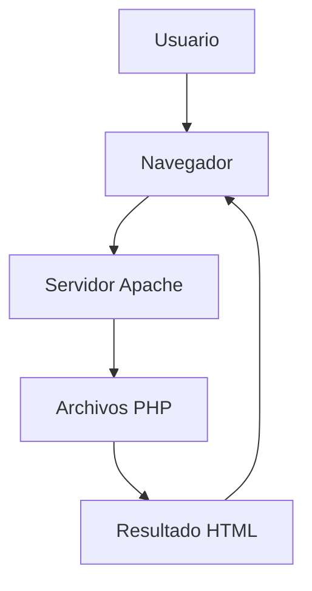

# Práctica 1PHP
Este proyecto contiene todos los ejercicios realizados en PHP en la práctica 1.

## Actividades del Proyecto

En este proyecto se realizan diferentes ejercicios para practicar PHP y HTML.

## Ejercicios Hechos

| Actividad | Descripción |
|:----------:|:------------|
| Actividad 1 | Presentación personal |
| Actividad 2 | Creación de la tabla de multiplicar |
| Actividad 3 | Notas de alumnos |
| Actividad 4 | Formulario de registro con pequeñas validaciones |
| Actividad 6 | Agenda de contactos |

## Información del proyecto

Estas actividades están hehcas en **PHP** y **HTML**.

Los ejercicios se han hecho para *practicar la programación con PHP*.

~~Proyecto sin terminar~~

**Proyecto en desarrollo.**

## Enlace

Puedes mirar la documentación oficial de PHP en el siguiente enlace:

[Documentación de PHP](https://www.php.net/manual/es/)

## Logo de PHP

## Historial de Cambios
Aquí se guardará todos los cambios que hagamos en la Práctica 1.
[Ver historial de cambios](CHANGELOG.md)

## Tareas pendientes

- [x] Crear los ejercicios de PHP.
- [x] Subir el proyecto a GitHub.
- [x] Crear el archivo README.md.
- [x] Crear el archivo CHANGELOG.md.
- [ ] Revisar la documentación del proyecto.
- [ ] Completar los ejercicios de Markdown.

## Avisos importantes

> [!NOTE]
> Para ejecutar los ejercicios es necesario tener PHP instalado.

> [!WARNING]
> Es importante iniciar Apache desde XAMPP antes de ejecutar los ejercicios en el navegador o tener otro servidor para poder visualizarlo.

## Información adicional

Los ejercicios se pueden ejecutar utilizando XAMPP[^1].

[^1]: XAMPP es un paquete que incluye Apache, MariaDB, PHP y Perl.

## Preguntas frecuentes

¿Cómo puedo ejecutar los ejercicios?

Para ejecutar los ejercicios debes iniciar Apache en XAMPP y abrirlos desde el navegador usando localhost.

¿Qué tecnologías se utilizan?

En este proyecto se utilizan PHP y HTML.

¿Necesito instalar algún programa?

Sí, necesitas un entorno de desarrollo como XAMPP y un editor de código como Visual Studio Code.

## Funcionamiento de la aplicación

